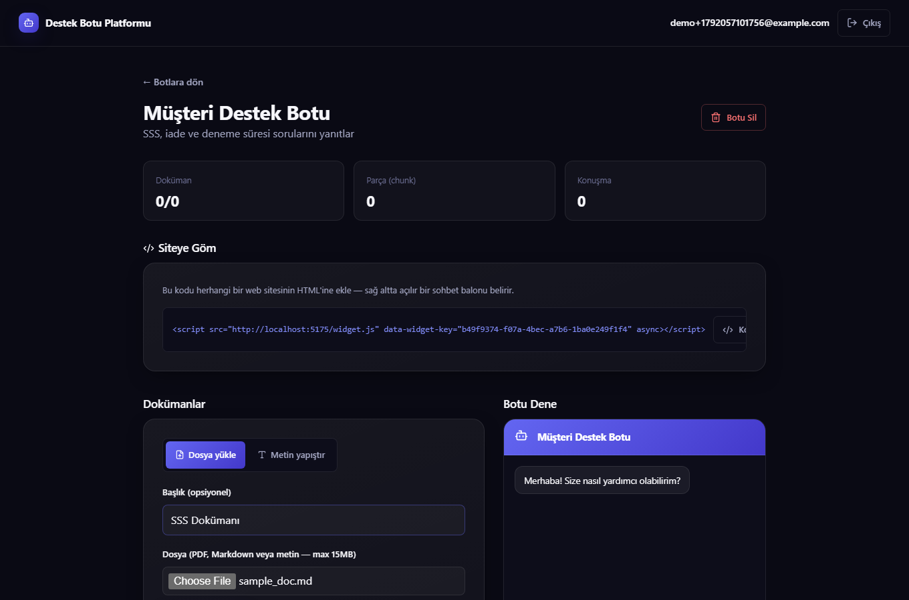
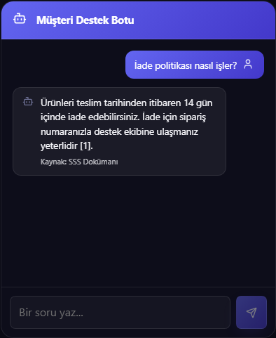
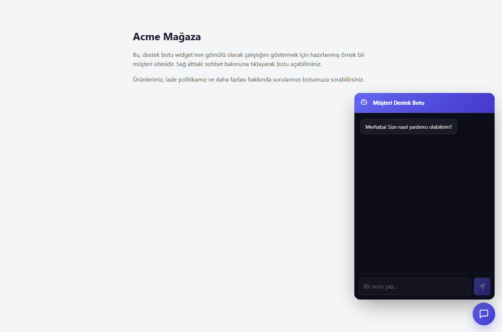

# RAG Destek Botu Platformu


**Full-stack bir portföy projesi:** React (frontend) + Ruby on Rails (API backend) + Google
Gemini (LLM ve embedding) ile uçtan uca geliştirilmiştir. Kendi dokümanlarını (PDF, Markdown
veya yapıştırılmış metin) yükleyip, yalnızca o dokümanlara dayanarak soru cevaplayan ve
herhangi bir web sitesine tek satır `<script>` ile gömülebilen bir RAG (Retrieval-Augmented
Generation) destek botu platformu.

## Öne Çıkan Noktalar

- **Uçtan uca full-stack mimari:** React (Vite) SPA + Ruby on Rails 8 API-only backend,
  JWT ile stateless kimlik doğrulama.
- **Gerçek bir RAG pipeline'ı:** doküman yükleme → metin çıkarma → chunk'lama → embedding
  üretme → sorgu zamanında benzerlik araması → LLM ile kaynak gösterilerek cevap üretme.
- **Asenkron iş işleme:** doküman işleme (`ProcessDocumentJob`) arka planda, kullanıcı
  arayüzünü bloklamadan çalışır; arayüz polling ile durumu canlı takip eder.
- **Mühendislik kararı ve gerekçesi:** hedef altyapıda `pgvector` kurulamadığı için
  benzerlik araması bilinçli olarak Ruby tarafında yeniden tasarlandı (bkz. aşağıdaki
  "Neden pgvector değil?" bölümü) — production'a geçişte tek satırlık migration yolu
  baştan planlandı.
- **Gömülebilir widget:** tek satır `<script>` ile herhangi bir siteye entegre edilebilen,
  bağımsız bir vanilla-JS widget + iframe mimarisi.

## Ekran Görüntüleri

| Doküman Yükleme | Sohbet | Gömülebilir Widget |
|---|---|---|
|  |  |  |

## Mimari

- **backend/** — Ruby on Rails 8 API (PostgreSQL, Active Storage, email/şifre + JWT auth, Gemini)
- **frontend/** — React (Vite) SPA; bot yönetim paneli + gömülebilir sohbet widget'ı aynı uygulamada

Akış:
1. Kullanıcı giriş yapar, bir **bot** oluşturur (her bot kendi `widget_key`'ine sahiptir).
2. Bota PDF/Markdown dosyası yükler veya metin yapıştırır → arka planda `ProcessDocumentJob` çalışır:
   metin çıkarılır (`pdf-reader` ile PDF'ten, veya doğrudan) → paragraf sınırlarına göre örtüşmeli
   parçalara (chunk) bölünür → her parça Gemini'nin embedding API'siyle vektöre çevrilir.
3. Bir ziyaretçi widget'tan soru sorduğunda: soru da embedding'e çevrilir → botun tüm parçaları
   arasında kosinüs benzerliğiyle en alakalı **4 parça** bulunur → bu parçalar + konuşma geçmişi
   Gemini'ye bağlam olarak verilir → üretilen cevap, hangi kaynaklardan alıntı yaptığına göre
   (`[1]`, `[2]`...) ilgili doküman adlarıyla birlikte döner.
4. Widget, `frontend/public/widget.js` üzerinden herhangi bir siteye gömülür: script sağ altta bir
   sohbet balonu enjekte eder, tıklanınca `/widget/:widget_key` sayfasını bir `<iframe>` içinde açar.

### Neden pgvector değil?

Proje fikri pgvector öneriyor, ancak bu makinedeki PostgreSQL 16 kurulumunda pgvector derlemek
Visual Studio build tool'ları gerektiriyor ve resmi olmayan üçüncü parti ikili dosyaları
PostgreSQL'e (yükseltilmiş ayrıcalıklarla çalışan bir sürece) kurmak istemedim. Bunun yerine
embedding'ler `float8[]` kolonunda saklanıyor ve benzerlik araması Ruby tarafında
(`Chunk#cosine_similarity`, `ChunkRetrievalService`) yapılıyor — portföy ölçeğindeki bir bot için
(bot başına birkaç bin parça) yeterince hızlı. pgvector kurulabilirse, tek değişiklik kolonu
`vector` tipine çevirip `ORDER BY embedding <=> ?` sorgusuna geçmek olurdu.

## Gereksinimler

- Ruby 3.4+, Rails 8+, PostgreSQL (zaten kurulu)
- Node.js 20+
- Bir Gemini API key (ücretsiz, kredi kartı gerekmez: https://aistudio.google.com/apikey)

## 1. Ortam Değişkenleri

`backend/.env` dosyası zaten oluşturuldu (git'e girmez). İçini doldur:

```
GEMINI_API_KEY=<Gemini API key>
```

`JWT_SECRET` ve `FRONTEND_URL` otomatik dolduruldu, dokunmana gerek yok.

## 2. Backend'i Çalıştırma

```bash
cd backend
bundle install          # ilk kurulumda zaten yapıldı
bin/rails db:create db:migrate   # ilk kurulumda zaten yapıldı
bin/rails server -p 3000
```

PostgreSQL servis olarak kayıtlı değil (bu makinede admin yetkisi gerektiği için atlandı).
Her oturumda önce şunu çalıştırman gerekir:

```bash
"C:\Program Files\PostgreSQL\16\bin\pg_ctl.exe" -D "C:\Program Files\PostgreSQL\16\data" -l "C:\Program Files\PostgreSQL\16\data\logfile.log" start
```

Doküman işleme (`ProcessDocumentJob`) development'ta Rails'in varsayılan `:async` adapter'ı ile
Puma sürecinin içinde çalışır — ayrı bir worker süreci gerekmez.

## 3. Frontend'i Çalıştırma

```bash
cd frontend
npm install              # ilk kurulumda zaten yapıldı
npm run dev
```

Tarayıcıda http://localhost:5175 açılır.

## 4. Botu Bir Siteye Gömme

Panelde bir bot oluşturup en az bir doküman ekledikten sonra, bot detay sayfasındaki embed
kodunu herhangi bir HTML sayfasına yapıştırman yeterli:

```html
<script src="http://localhost:5175/widget.js" data-widget-key="BOTUN-WIDGET-KEY-DEGERI" async></script>
```

Sayfayı açtığında sağ altta bir sohbet balonu belirir; tıklayınca bot açılır.

## Teknoloji Özeti

| Katman | Teknoloji |
|---|---|
| Backend | Ruby on Rails 8 (API-only), PostgreSQL, Active Storage |
| Auth | Email/şifre (`has_secure_password`) + JWT (SPA için stateless auth) |
| PDF metin çıkarma | `pdf-reader` (saf Ruby, native bağımlılık yok) |
| Embedding | Google Gemini `gemini-embedding-001` (`batchEmbedContents` / `embedContent`, 768 boyut) |
| Üretim (LLM) | Google Gemini `gemini-2.5-flash` — sadece verilen bağlamdan cevap üretir |
| Benzerlik araması | Ruby içinde kosinüs benzerliği (bkz. yukarıdaki pgvector notu) |
| Frontend | React 19 + Vite, React Router, Axios |
| Widget | Bağımsız `widget.js` (vanilla JS) + `/widget/:key` React sayfası, `<iframe>` ile gömülü |

## Güvenlik Notu

`backend/.env` ve `backend/config/master.key` asla commit edilmez (`.gitignore`'da hariç
tutuldu). Şifreler `bcrypt` ile hash'lenir, her kullanıcı yalnızca kendi botlarını görür/düzenler.
Widget uç noktaları (`/api/widget/*`) kasıtlı olarak herhangi bir origin'den CORS'a açık ve JWT
gerektirmez — tahmin edilmesi zor bir UUID (`widget_key`) ile korunur. Bu, portföy/demo ölçeği
için yeterli; gerçek bir prodüksiyonda rate limiting (örn. `rack-attack`) ve bot başına izinli
domain listesi eklenmesi gerekir.
